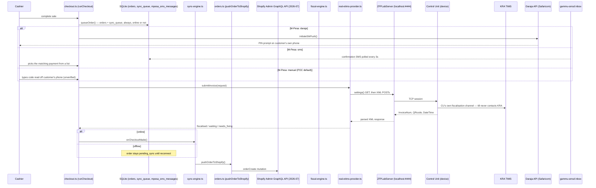
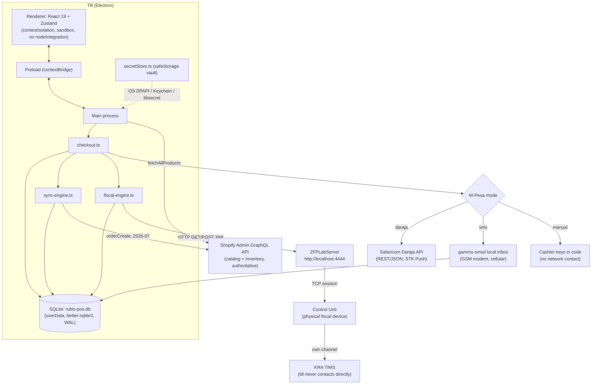

# Phase 175 — Requirement audit: does the POS already do it, can Shopify provide it, or is it neither?

- **Date:** 2026-09-28
- **Requested:** Audit-only (read-only). Answer Rubis Finance and Operations' requirement questions against the POS codebase and Shopify's public documentation: does the till already do it, can Shopify provide it, or is it neither. No code changes.
- **Outcome:** No change needed. This report is the deliverable.
- **Branch / base commit:** staging @ 6ae7ef2 (chore: bump to 2.0.4)

A note on terms used throughout: "the till" or "the POS" means this one Electron app running on one physical checkout machine, with its own local database. "Shopify" means the e-commerce/inventory platform this till reads its product catalog from and pushes sales to. "Flient" is Rubis's wider back-office platform, referred to here only where a requirement clearly belongs to a chain-wide system rather than a single till.

**Method note:** every code citation below was re-verified against the live repository at commit `6ae7ef256a96ef8ca74e740886f4b2745bfa2a3a` on branch `staging`. An earlier research pass accidentally ran against an isolated copy of the repository pinned to a commit from 2026-09-09 (three weeks and dozens of phases stale) and produced two false claims — that `docs/KNOWN_GAPS.md` had no profit/margin entry, and that no fiscal reconciliation report existed. Both were re-checked directly against the live file and found to be present and correct; that stale pass was discarded in full and every finding below comes from a fresh audit of the current code.

---

## 1. Summary

### POS today — across all 28 Finance + Operations requirement rows (Section 12's eight reports counted individually, as instructed)

| POS today | Count |
| --- | --- |
| Yes (built and tested) | 3 |
| Yes, not proven on real hardware | 0 (one Finance row carries this as a secondary note — see F1) |
| Partly | 6 |
| No | 15 |
| Not POS scope | 4 |
| **Total** | **28** |

### Shopify can provide? — same 28 rows

| Shopify can provide? | Count |
| --- | --- |
| Yes | 6 |
| Partly | 8 |
| No | 3 |
| Not documented | 11 |
| **Total** | **28** |

Reading the two tables together: of the 28 things asked about, the till already fully does 3, partly does 6, and either cannot do or the question does not belong to a single till for 19. Shopify's own documented feature set can fully cover 6, partly cover 8, and clearly cannot cover 3 — the remaining 11 are things Shopify's public documentation simply does not state either way, not things confirmed absent.

---

## 2. Finance requirements

Legend for "POS today": **Yes** = built and tested · **Yes*** = yes, not proven on real hardware · **Partly** · **No** · **Scope** = not POS scope.

| # | Question | POS today | Where (file:line) | Shopify can provide? | Shopify evidence | Gap / what is needed |
| --- | --- | --- | --- | --- | --- | --- |
| F1 | KRA eTIMS system-integration certification | **Scope** | `src/main/services/integrations/real-etims-provider.ts:1-45`, `http-client.ts:8-59` (the technical route itself is **Yes, not proven on real hardware** — see note) | Not documented | Not searched — eTIMS is a Kenya Revenue Authority fiscal system, outside Shopify's product | Whether Volcha/Flient/RUBIS holds KRA's OSCU/VSCU system-integrator certification is a legal fact held with KRA, not something any codebase can prove. What the code shows: the till talks only to a local vendor "ZFPLabServer" (`http://localhost:4444/`) over HTTP (GET for session commands, POST of XML for fiscal commands, `Content-Type: text/plain`), which itself holds a TCP session to the physical Control Unit device; KRA is never contacted directly by the till. `docs/KNOWN_GAPS.md:23-24` confirms this build has never completed a session against a live device. **Needed: written confirmation of certification status from Rubis's legal/compliance team, separate from this audit.** |
| F2 | Stock take approval hierarchy | **Yes** | `src/main/services/stock-take.ts:259-315` (`evaluateApproval`), `:67-77` (zero-KES default threshold), `:512-913` (submit → preview → commit flow); IPC at `src/main/index.ts:3466-3655` | Not documented | Not researched | None — this is built and tested (`tests/stockTake.test.ts:399,422,445,484,492`). The counter cannot approve their own count, and every count that moves any value needs a second, different manager approver until a real threshold is configured. |
| F3 | Real-time inventory | Partly | `src/main/services/database.ts:483-492` (`products` cache table), `shopify.ts:83-105,602-681` (fetch), `src/main/index.ts:1166-1201` (`products:fetch`, falls back to cache on failure) | Yes | help.shopify.com/en/manual/locations/getting-started-with-locations, "Track inventory separately at each physical location"; help.shopify.com/en/manual/products/inventory/adjusting-inventory/adjusting-inventory-quantities, quantities update automatically in Admin as orders are placed. Checked 2026-09-28; plan not stated. | Shopify itself tracks inventory live per location. The till only refreshes its own local copy on app launch, a manual refresh tap, or a few admin actions — no polling loop, no webhook receiver. **Needed (POS): either a periodic refresh or a Shopify webhook receiver so the till's product cache stays current without a manual tap.** |
| F4 | Generate LPOs and show existing stock when re-ordering | No | Repo-wide search for "purchase order", "LPO", "reorder", "PO number" in `src/` — no matches | Yes | help.shopify.com/en/manual/products/inventory/purchase-orders, "You can create purchase orders in your Shopify admin to record the commercial agreements that you make with your suppliers." Status flow Draft → Ordered → Receive inventory documented at .../purchase-orders/receiving-inventory. Checked 2026-09-28; plan not stated. | The till has no purchase-order concept at all. Shopify's own native Purchase Orders feature already does this — creating a PO from within Shopify Admin naturally shows the product's current stock alongside it, though that exact detail is not separately confirmed by a quoted doc sentence. **Needed: adopt Shopify's native Purchase Orders (Shopify setup) rather than build one into the till.** |
| F5 | Re-order levels; automatic re-orders or alerts | No | `database.ts:483-492` — no `reorder_level`/`min_stock` column; repo search for "reorder", "low stock", "threshold" finds only unrelated constants | Partly | help.shopify.com/en/manual/products/inventory/transitioning-from-stocky — Shopify's own calculated Reorder Points (Stocky) "will no longer be available after August 31st, 2026"; the documented replacement is manual custom metafield thresholds per variant, plus Shopify Flow automations for low-stock alerts ("Set up automated low-stock alerts using Shopify Flow"). Checked 2026-09-28; plan not stated. | Neither the till nor Shopify's native, still-supported feature set offers a true calculated reorder point with automatic PO generation any more — the tool that did this (Stocky) was retired the same month this audit runs. **Needed (Shopify setup): configure custom metafield thresholds + Shopify Flow alerts as the current recommended substitute; a true auto-reorder feature does not exist natively today.** |
| F6 | Audit trails of transactions | Partly | `database.ts:493-520` (`orders` table, incl. `staff_id`, `status`), `:553-563` (`shifts`), `:754-779` (`mpesa_day_approvals`/`mpesa_day_exclusions`, records who approved and who excluded, with a reason) | Not documented | Not researched | Orders, shift cash counts, and M-Pesa day-approvals are durable and attributed to a staff member. But there is no dedicated audit-log table: a void has no recorded actor or reason (`docs/KNOWN_GAPS.md:320-329`, void is refused entirely at the till since Phase 131 in any case), and a price override has no persisted record at all beyond the sale's own line total (`docs/KNOWN_GAPS.md:395-427`). **Needed (POS): a proper append-only audit-log table capturing who did what, when, for voids, overrides, and manager-PIN uses.** |
| F7 | Consolidated reports across a 100-outlet chain | No | `src/main/services/reports.ts:1-8` (module doc: "read directly from the local `orders` ledger — no network access"), all report functions take only this till's own `RubisDatabase` | Yes | help.shopify.com/en/manual/fulfillment/setup/locations/setup, exact quote: "Starter: 2 locations. Basic: 10 locations. Grow: 10 locations. Advanced: 10 locations. Shopify Plus: 200 locations." help.shopify.com/en/manual/reports-and-analytics/shopify-reports (reports display up to 1,000 rows). Checked 2026-09-28. | Every report in this codebase is scoped to one till's own SQLite file — there is no multi-store aggregation anywhere. Shopify itself can aggregate sales/catalog data across locations, but **only on the Shopify Plus plan** for a 100-outlet chain (Basic/Grow/Advanced cap at 10 locations). **Needed: Shopify Plus (Shopify setup) for Shopify-side consolidation; a separate chain-wide view is still needed for anything that only exists on the till (fiscal filing status, Z-reports, cash reconciliation) — that is a Flient-platform build, not a Shopify or till feature.** |
| F8 | Recipe management | No | Repo-wide search for "recipe", "ingredient", "BOM" in `src/` — zero matches | No | help.shopify.com/en/manual/products/bundles — Shopify's only related native feature is "Product bundles," explicitly a merchandising/discount grouping, with no mention of automatic ingredient/component inventory deduction. No Shopify-owned page documents a native recipe/BOM feature. Checked 2026-09-28. | Neither exists. A recipe/BOM system would need a third-party Shopify app or a Flient-platform build — nothing native covers this. **Needed: Flient platform (or a chosen third-party app), not the till.** |
| F9 | A functional finance module | No | Repo-wide search for "ledger", "journal", "chart of accounts", "payable", "receivable" — only informal, unrelated uses of "ledger" as a word | No | help.shopify.com/en/manual/finance/overview — Shopify's "Finance" area is Shopify Balance, Shopify Credit, Shopify Capital, Bill Pay and payouts — a money-movement/banking dashboard, explicitly not general-ledger or accounts payable/receivable software. Checked 2026-09-28. | Neither the till nor Shopify has this. **Needed: Flient platform, or a dedicated accounting package (e.g. QuickBooks/Xero) — genuinely outside both the till's and Shopify's product scope.** |
| F10 | Create custom reports as needed | Partly | `src/main/services/reports.ts` — a fixed set of report functions; `src/renderer/src/pages/ReportsPage.tsx:44-54` — six hardcoded sub-views, no user-defined filters/columns beyond fixed date-range presets | Partly | help.shopify.com/en/manual/reports-and-analytics/shopify-reports/using-reports/filter-and-edit — saving a filtered/custom report for later needs the **Advanced Shopify plan or higher** ("If you want to save the filtered report for future use and your store is on the Advanced Shopify plan or higher, you can click 'Save as'"). Building/exploring a report is available on all plans. Checked 2026-09-28. | The till's report set is fixed; CSV export exists for two shapes only (see F12/technical Q12). Shopify's own report builder can go further, but persisting a custom report needs Advanced Shopify or above. **Needed (Shopify setup): Advanced plan or higher if ad-hoc saved reports are required from Shopify's own data.** |
| F11 | Integrate with Oracle if needed | No | Repo-wide search for "oracle" in `src/` and `docs/` — zero matches | No | Searched help.shopify.com/en/manual/b2b/reports-and-automations/external-integrations and the App Store listing for the Oracle NetSuite connector; no Shopify-owned documentation states a native Oracle connector — only a third-party app built by Oracle itself, or the general Admin API. Checked 2026-09-28. | Nothing native exists on either side. **Needed: Flient platform, built against the Shopify Admin API (and/or the third-party Oracle NetSuite connector app), not the till.** |
| F12a | Stock movement report | No | Not present in `reports.ts` (checked in full) | Not documented | Not researched specifically | No report of this shape exists on the till; Shopify's own inventory-history features were not specifically checked for this. |
| F12b | Sales report showing CU Invoice Number *and* Trader System Invoice Number | Yes | `src/renderer/src/pages/ReportsPage.tsx:498-584` (Invoice List view, both columns), `reports.ts:949-992` (`buildReconciliationRow`), `reportsExport.ts:79-80` (both as CSV columns) | Not documented | Not researched — these are KRA-specific identifiers with no Shopify equivalent | Built and tested; no gap. |
| F12c | Summary profitability report | No | No cost data anywhere in the schema — see `docs/KNOWN_GAPS.md:290-318`, quoted under F13/technical Q8 | Not documented | Not researched as its own item; Shopify's own `orderCreate`-sourced-order-in-profit-reports question is separately confirmed as undocumented (see F13's Gap column) | Needs cost data captured somewhere first (see F12f). |
| F12d | Detailed profitability report | No | Same as F12c | Not documented | Same as F12c | Same as F12c. |
| F12e | Daily payments report | Yes | `reports.ts:240-257` (`generateDailySummary`), `:429-525` (`generateEndOfDayReport`); `tests/reports.test.ts:209,260` | Partly | help.shopify.com/en/manual/payments/shopify-payments/payouts/payout-reconciliation-report — covers Shopify Payments transactions only; explicitly excludes "third-party payment processors, or third-party payment methods." Checked 2026-09-28. | The till's own report already covers cash + both M-Pesa routes + card-label sales for one till. Shopify's payout report would only ever cover Shopify Payments transactions, which this till does not use for any tender type today. |
| F12f | Stock valuation report | No | Not present in `reports.ts`; `products` table has no cost column (`database.ts:483-492`) | Partly | help.shopify.com/en/manual/reports-and-analytics/shopify-reports/report-types/default-reports/inventory-reports — a "Month-end inventory value" report exists, but depends on the merchant populating `cost per item` on every product, and on the separate "View cost"/"Edit cost" store permission (help.shopify.com/en/manual/your-account/users/roles/permissions/store-permissions). Checked 2026-09-28. | Shopify can do this natively, but only once cost-per-item is actually maintained for every product — which this store has never done (`docs/KNOWN_GAPS.md:290-318`: "this app has never read or requested that field or permission"). **Needed (Shopify setup): populate `cost per item` for the catalog and grant the "View cost" permission; no till-side change needed if this report is read directly in Shopify Admin.** |
| F12g | Closing stock report | No | Not present in `reports.ts` | Not documented | Not researched specifically as this exact report name | No till-side report exists; not separately confirmed on the Shopify side either. |
| F12h | Stock variance report (quantity, cost, selling values) | Partly | `stock-take.ts:150-244` (`StockTakePreviewLine`, `computeVarianceValue`) computes quantity and selling-value variance per stock-take session, but carries no cost figure and is not exposed as a standalone report | Partly | Same Shopify evidence as F12f (inventory value report, cost-dependent) — Shopify's report is a valuation snapshot, not confirmed to show a variance-from-physical-count specifically. Checked 2026-09-28. | The till computes quantity + selling-value variance already, inside the stock-take approval workflow, but never against a cost figure (none exists) and not as a queryable report. **Needed (POS): expose the existing stock-take variance data as a Reports-tab view; needs a cost figure from Shopify (see F12f) to add the cost column.** |
| F13 | M-Pesa and bank integration | Partly | `mpesa-provider-factory.ts:52` (`'manual' \| 'daraja' \| 'sms'`); `daraja-mpesa-provider.ts` (real Daraja REST); `sms-mpesa-provider.ts`/`gammu-inbox.ts` (real SMS confirmation); repo-wide search for "bank" — zero genuine matches; "card" is a label only, no processor wired (`checkout.ts` has no card-processing code) | Partly | help.shopify.com/en/manual/payments/shopify-payments/supported-countries — Kenya is **not** among the ~38 listed countries, so Shopify Payments (and its bank payout) is not available to this merchant at all. No Shopify local-payment-methods page documents M-Pesa as a native gateway. Checked 2026-09-28. | M-Pesa is genuinely integrated two ways (Daraja API, SMS-read). Card is a label with no processor behind it. Direct bank integration (RTGS, bank API) does not exist on the till, and Shopify Payments — the only bank-payout path Shopify documents — is not available to a Kenya-based merchant at all. **Needed: if direct bank integration is required, it must be built outside Shopify (Flient platform or a dedicated banking API integration), since Shopify has no route into Kenya for this.** |

---

## 3. Operations requirements

| # | Question | POS today | Where (file:line) | Shopify can provide? | Shopify evidence | Gap / what is needed |
| --- | --- | --- | --- | --- | --- | --- |
| O1 | Product transfers between branches | **Scope** | `src/main/services/database.ts` — no transfer table; the only cross-location concept is `shopify.ts`'s single-location `locationId` scoping (`:598-648`), confirmed by `tests/pagination.test.ts:209,224` to only ever show or drop this till's own location's stock, never move it | Yes | help.shopify.com/en/manual/products/inventory/inventory-transfers/creating-and-managing-transfers — "You can create inventory transfers to move and track inventory between your store locations." A distinct feature from Purchase Orders, though a PO can generate a linked transfer once marked "Ordered." Checked 2026-09-28; plan not stated. | A branch-to-branch transfer is chain-wide by nature and cannot be represented in one till's local database. Shopify already has a native Transfers feature. **Needed: adopt Shopify's native Transfers (Shopify setup); no till change needed.** |
| O2 | Transfer/migrate the database from the current system | No | No import tooling anywhere in `src/main/` or `scripts/`; `configMigration.ts` is confirmed to be an internal, one-time settings seed only (`VITE_USE_MOCK_*` flags → `app_configurations`), not external data import; `scripts/reset-local-data.cjs` wipes local data, the opposite of importing it | Not documented | Not researched | No import tool of any kind exists on the till. **Needed: a one-time migration tool (POS or Flient platform, depending on whether the "current system" being replaced is per-branch or chain-wide) — not proposed or built here.** |
| O3 | Product creation and price setting: centralised or per-branch | **Scope** | `shopify.ts` — no `productCreate`/`productUpdate`/`productVariantUpdate` mutation exists anywhere, only catalog queries; the only price-related till feature, `priceOverride` (`checkoutMath.ts:211-228`), is a capped per-sale-line override, not catalog editing, and is disabled once a sale is live-fiscal | Partly | help.shopify.com/en/manual/products/details/product-pricing/determine-pricing — base price is set once per product/variant, store-wide by default. Region/market variation needs Shopify Markets; customer/company-location-specific pricing needs B2B catalogs (capped at 3 active catalogs on Basic/Grow/Advanced, unlimited with location-level assignment on Shopify Plus per help.shopify.com/en/manual/b2b/catalogs/creating-catalogs). Checked 2026-09-28. | Product master data is entirely Shopify-owned; the till cannot create or price-edit a catalog item at all, only override what one specific sale charges within a 50% ceiling. Genuine per-branch pricing (not per-customer/market) is not confirmed as a native Shopify capability — B2B catalogs are designed for customer segmentation, not "branch A charges X, branch B charges Y" retail pricing. |
| O4 | Ordering alerts for high-margin products | No | No margin concept anywhere; `products` table has no cost column; `docs/KNOWN_GAPS.md:290-318` quoted in full under F12c | Not documented | Shopify's low-stock-via-Flow capability (see F5) was confirmed, but filtering specifically by margin was not documented anywhere researched | Structurally impossible without cost data first (see F12f). **Needed: cost data in Shopify (Shopify setup) before any margin-based alert, till-side or Shopify-side, can exist.** |
| O5 | Lock items not on the category list from being ordered | No | No ordering/receiving flow exists on the till at all (see O7), so there is nothing to lock; `AppConfigCategory` in this codebase is an unrelated app-settings category, not a product category | Not documented | Not researched | Moot on the till until an ordering flow exists. |
| O6 | Connect to an external analytics system | No | Repo-wide search for "analytics", "webhook", "segment", "mixpanel" in `src/` — no genuine matches; no Shopify webhook-registration capability exists in `shopify.ts`; only a manual CSV export exists as a possible data-export path | Yes | help.shopify.com/en/manual/reports-and-analytics/google-analytics/google-tag-manager — "It's recommended that you use Shopify's built-in integration to Google Analytics." Customer-event pixels for other tools: help.shopify.com/en/manual/promoting-marketing/pixels/overview and shopify.dev/docs/apps/build/marketing-analytics/pixels. Checked 2026-09-28. | The till has no live analytics connection of any kind. Shopify itself has a native GA4 integration and a general pixel/webhook/Admin API framework for other tools. **Needed (Shopify setup): use Shopify's own analytics/pixel integrations for sales data; the till itself would need a webhook receiver built if till-only data (cash, fiscal status) must also feed an external analytics tool — not built today.** |
| O7 | How ordering and receiving works today | **Scope** | No `ipcMain.handle` in `src/main/index.ts` covers purchasing; the only "order"-named channel, `orders:void`, is a **sales**-order void, unconditionally refused since Phase 131 (`docs/KNOWN_GAPS.md:320-329`); no ordering/receiving UI exists in `src/renderer/src/components` | Yes | Same evidence as F4 (Purchase Orders) and O1 (Transfers) — help.shopify.com/en/manual/products/inventory/purchase-orders and .../inventory-transfers/creating-and-managing-transfers. Checked 2026-09-28. | Nothing happens in the till today — if any ordering/receiving process exists at Rubis currently, it happens entirely outside this codebase. Shopify's own Purchase Orders + Transfers features are the natively documented route. |
| O8 | Availability report — is an item available in the shops or not | Partly | `src/renderer/src/components/VariantModal.tsx:106,129-131` — an inline "in stock"/"Out of stock" indicator, shown only inside the variant-picker modal for multi-variant products; `ProductCard.tsx` (91 lines, read in full) shows no stock indicator at all on the main product grid; `tests/pagination.test.ts:224` — a product out of stock at this till's location is silently dropped from the catalog rather than shown as unavailable | Partly | Same evidence as F3 (per-location inventory tracking is native to Shopify) — help.shopify.com/en/manual/locations/getting-started-with-locations. Checked 2026-09-28. | This is an inline indicator on one screen, not a report, and it does not appear for most products (single-variant items show nothing). Shopify itself holds accurate per-location stock, which is the right source for a genuine chain-wide availability report. **Needed: a dedicated availability view, most naturally built by reading Shopify's own per-location inventory data (Shopify setup for the data; Flient platform or POS for the view, depending on whether it needs to span every branch or just this till).** |

---

## 4. Technical questions

### T1. Data flow

**(a) Till → Shopify.** A completed sale is written to `orders` + `sync_queue` first, always, regardless of connectivity (`src/main/services/database.ts:763-819`/`queueOrder`). If online, `sync-engine.ts` fires immediately after checkout; otherwise it waits for its own 30-second poll or the next offline→online transition. `pushOrderToShopify` (`src/main/services/orders.ts:135-191`) sends an `orderCreate` GraphQL mutation — line items, `financialStatus: PAID`, an inventory-decrement instruction, and a `client_order_uuid` for de-duplication. The product catalog is read back via `fetchAllProducts`/`fetchInventoryLevels` (`shopify.ts:602-681`, `:82-105`) against the Shopify Admin GraphQL API, version **2026-07** (`shopify.ts:19`).

**(b) Till → ZFP Lab Server → Control Unit → KRA.** The till talks only to a local vendor service, "ZFPLabServer," at `http://localhost:4444/` — HTTP, not SOAP. Session/admin commands are literal-string GETs (e.g. `settings(ip=…,port=…,password=…,tcp=1)`); fiscal commands are XML POSTs with `Content-Type: text/plain` (`src/main/services/integrations/http-client.ts:8-59`). ZFPLabServer holds the real TCP session to the physical Control Unit device, and the Control Unit is what actually communicates with KRA — **the till never contacts KRA directly**. A sale runs a fixed seven-step sequence: `settings()` → `ReadStatus` → `OpenInvoiceWithFreeCustomerData` → `SellPLUfromExtDB`(`_HS`) per line → `ReadCurrentReceiptInfo` → `CloseReceipt` → `ReadDateTime` (`real-etims-provider.ts:23-34,871-1115`).

**(c) Till → M-Pesa.** Three confirmation routes, chosen per store config (`mpesa-provider-factory.ts:52`, `MpesaConfirmationMethod = 'manual' | 'daraja' | 'sms'`):
- **`daraja`** — a real Safaricom Daraja REST/JSON STK Push; the customer confirms on their own phone; the till polls the till's own stored STK result rather than trusting a public callback (none is configured).
- **`sms`** — a real, automatic confirmation read off a GSM modem via gammu-smsd, polled every 3 seconds; the cashier still has to pick the matching payment from a list at the till.
- **`manual`** — the POC default; the cashier reads a code off the customer's own phone and types it in; nothing is checked against Safaricom at all, and the payment is recorded as `manual_unverified`.



### T2. Centralised or decentralised

Local-only (SQLite, one file per till, `database.ts`'s schema): `products` (a Shopify catalog **cache**, not authoritative), `orders`, `sync_queue`, `settings`, `staff`, `shifts`, `integrations`, `printers`, `mpesa_transactions`, `mpesa_sms_messages`, `app_configurations`, `stock_take_sessions`, `stock_take_items`, `mpesa_payments`, `mpesa_day_approvals`, `mpesa_day_exclusions`.

Centrally authoritative: Shopify, for catalog and inventory. Quoted directly, `docs/KNOWN_GAPS.md:313-315`: *"The till should not become a second source of cost/margin truth either way (Shopify is the only stock ledger - a project rule, not a preference)."* Restated in `docs/phase-157.md:196`: *"Shopify is the only stock ledger (never propose a second); Shopify first, keep the till thin; multi-shop/consolidated reporting is not the till's job."*

No till-to-till channel exists anywhere — every sync path goes till↔Shopify, till↔ZFPLabServer/Control Unit, or till↔Daraja/SMS-modem.

### T3. Offline behaviour

| | With no internet | Catches up when |
| --- | --- | --- |
| Sale/checkout | Completes normally — never blocked. Written to `orders`/`sync_queue` first, always. | `sync-engine.ts` fires on the offline→online transition, plus a 30s poll |
| Fiscal filing | Unaffected — the fiscal device chain is LAN-local, not internet-dependent | `fiscal-engine.ts` retries every 30s or on reconnect (used only as a "worth checking now" signal, not a gate) |
| M-Pesa: daraja | Blocked — requires internet to reach Safaricom | N/A while offline |
| M-Pesa: sms | Unaffected — the modem reads cellular SMS locally, no internet needed | N/A |
| M-Pesa: manual | Unaffected — nothing is contacted over any network | N/A |
| Receipt print | Unaffected — LAN/USB to a local printer | N/A |

### T4. Database

**Engine:** `better-sqlite3` `^13.0.3` (`package.json:52`). **File:** `join(app.getPath('userData'), 'rubis-pos.db')` (`src/main/index.ts:479`), permission-restricted to the owner. WAL mode. **Holds:** see the table list under T2.

### T5. Backend technology

Electron `^43.4.1` (`engines.electron: ">=28"`); Node `engines.node: ">=24 <25"`, enforced by `scripts/check-node-version.cjs` at every relevant npm script; TypeScript `^5.9.0`. Production dependencies, verbatim from `package.json:50-61`:

```
@electron-toolkit/preload  ^3.0.2
@electron-toolkit/utils    ^4.0.0
axios                      ^1.19.0
better-sqlite3             ^13.0.3
dotenv                     ^17.4.2
electron-updater           ^6.3.9
node-thermal-printer       ^4.6.1
pdfkit                     ^0.20.1
react                      ^19.2.0
react-dom                  ^19.2.0
zod                        ^4.4.3
zustand                    ^5.0.15
```

### T6. Frontend technology

React `^19.2.0`; build tool `electron-vite ^5.0.0` over `vite ^7.1.0`; styling `tailwindcss ^4.3.3`; state management `zustand ^5.0.15`; input validation `zod ^4.4.3` shared with the main process; `pdfkit`/`node-thermal-printer` for the two receipt-rendering paths.

### T7. Web service technologies

- **Shopify Admin API:** GraphQL, version string **`2026-07`**, pinned at `shopify.ts:19`.
- **ZFP Lab Server:** HTTP (not SOAP) — GET for session commands, POST of XML with `Content-Type: text/plain` for fiscal commands.
- **Daraja (M-Pesa):** REST/JSON.
- No other external web service is called anywhere in `src/main/services/` beyond these three.

### T8. Security measures

- **Credential storage:** no `keytar` package. Electron's own `safeStorage` (Windows DPAPI / macOS Keychain / Linux libsecret) encrypts secrets into `secret-vault.json` in the app's userData folder, permission-restricted to the owner. Stores the Shopify Admin token and the fiscal device's TCP password. Non-secret config lives in plain SQLite tables.
- **PIN hashing:** `crypto.pbkdf2Sync`, 100,000 iterations, SHA-512, per-PIN random salt, compared with `timingSafeEqual`. No plaintext PIN column exists anywhere.
- **Roles / manager re-verification:** `StaffRole = 'admin' | 'cashier'`. `requireAdminPin.ts` independently re-checks a claimed manager PIN server-side (never trusting the renderer alone) — used across roughly 18 privileged writes (staff creation, printer config, integration config, stock-take commit, report-day approval, Shopify store URL, and more).
- **IPC input validation:** every privileged/structural IPC payload is validated with `zod` (~47 schemas in `ipcValidator.ts`); a failed validation returns a clean typed failure rather than letting bad data reach business logic or the database.
- **Electron settings:** `sandbox: true`, `contextIsolation: true`, `nodeIntegration: false`, `webSecurity: true`, all hardcoded (not environment-conditional). A strict Content-Security-Policy is applied in every packaged build; a relaxed one applies only under `electron-vite dev`, never packaged.
- **Secrets never logged:** enforced by a redaction helper (`http-client.ts`'s `redactPassword`) plus a dedicated test — `tests/http-client.test.ts`, *"with debug on, logs the request URL but redacts the real device password."*
- **What is not yet protected** — quoted in full, `docs/KNOWN_GAPS.md:344-370`:

  > **`reports:*` read channels have no server-side role check (docs/phase-158)**
  >
  > The Admin Reports tab (and the older Z-report/daily-summary/end-of-day screens) are reachable in the renderer only when `currentStaff.role === 'admin'` (`App.tsx`), but every `reports:*` **read** IPC channel... has no matching check in the main process. This was investigated explicitly for docs/phase-158: the main process has **no concept of a currently logged-in staff member at all**... Inventing a session, or bolting a PIN prompt onto a read, was explicitly ruled out for docs/phase-158 rather than done as a workaround.
  >
  > **What's still open**: whether this POC needs a real session concept in the main process... is a product/engineering decision, not something to guess at. Until then, any `reports:*` read is reachable by any authenticated renderer script regardless of which screen is showing — a low-severity gap today (the data is read-only and store-internal), but one that should not silently widen as more `reports:*` reads are added.

### T9. System schematic



### T10. Backup and restore

**None.** No scheduled backup, export, or copy mechanism exists anywhere in the codebase for `rubis-pos.db` or `secret-vault.json`.

If a till's disk failed today, it would lose: every order not yet synced to Shopify; every sale rung up and paid for but not yet filed with KRA, along with which invoice numbers were already issued for the ones that did fiscalise; all staff accounts and PIN hashes; all shift and cash-reconciliation history; printer configuration; every M-Pesa record across all three modes, including the transaction-code dedup ledger that stops a payment being spent twice; stock-take history; and all local settings. The two secrets in the credential vault (Shopify token, fiscal device password) can be re-entered from the Admin screen; nothing else can be recovered.

### T11. eTIMS provisions integrated

| Provision | Status | Evidence |
| --- | --- | --- |
| Invoice filing | Built and tested | `real-etims-provider.ts:871-1115`; `tests/realEtimsProvider.test.ts`, `tests/tremolConformance.test.ts` |
| Device status check | Built | `config:test-etims` IPC handler → `fiscal-connection-test.ts`, a 3-hop server/device/ready check |
| CU date/time and serial capture | Built | `ensureCUNumbers()` and `ReadDateTime` step, persisted to `orders.fiscal_cu_serial`/`fiscal_fiscalized_at` |
| Duplicate-filing guard | Built, unverified on a live device | `docs/KNOWN_GAPS.md:65-112`, quoted: *"No live duplicate-`TraderSystemInvNum` rejection has ever been captured."* |
| Credit/debit notes | Built at the provider level, **wired into no caller** | `docs/KNOWN_GAPS.md:7-35`, quoted: *"`cancelInvoice` is not called from anywhere in the app yet... Per Phase 60's brief, this is deliberate — do not wire it into the live checkout path."* |
| Daily closure (`DailyReport`) | **Not built** | `docs/KNOWN_GAPS.md:203-247`, quoted: *"is not wired into this app at all... no command in this family is ever sent."* |
| Reconciliation report | Built, with two caveats | `reports.ts:1012` (`generateFiscalReconciliation`); `docs/KNOWN_GAPS.md:267-286`, quoted: *"VAT-group `'D'` is excluded from every derived VAT figure... The report is only as good as what the device actually returns."* |
| Receipt fields | Built | `receiptFiscalBlock.ts:78-98` prints the CU invoice number, a CU date/time line, and CU serial when present; `receiptLayout.ts` carries the QR code as text, never an image. The Trader System Invoice Number is not printed on the receipt itself, only shown in reports/CSV export. |

### T12. Integration modes supported

- **API:** Shopify Admin GraphQL (2026-07), ZFP Lab Server HTTP/XML, Daraja REST/JSON.
- **File/CSV:** export only — `reports:export-csv`, `reportsExport.ts`/`csv.ts` (with formula-injection protection). No CSV import of any kind exists.
- **SMS parsing:** a genuine fourth mode, independent of internet — `gammu-inbox.ts`/`mpesa-sms-inbox.ts`, reading M-Pesa confirmations off a GSM modem.

---

## 5. What we would need to build

| Item | Marked | Notes |
| --- | --- | --- |
| Audit log for voids, price overrides, manager-PIN uses | POS | No append-only log exists today; needs a new table and capture points |
| Periodic/webhook product-catalog refresh | POS | Currently refreshed only on load or manual tap |
| Stock-take variance shown as a Reports-tab view | POS | The data already exists inside the stock-take workflow; needs surfacing |
| One-time data-migration tool from the "current system" | POS or Flient platform | Depends on whether the current system is per-branch or chain-wide |
| Adopt Shopify's native Purchase Orders | Shopify setup | Already built by Shopify; nothing to build |
| Adopt Shopify's native Transfers | Shopify setup | Already built by Shopify; nothing to build |
| Reorder alerts via Shopify Flow + metafield thresholds | Shopify setup | Stocky's own calculated reorder points retired 2026-08-31 |
| Cost-per-item populated in Shopify, "View cost" permission granted | Shopify setup | Prerequisite for stock valuation, variance-with-cost, and any profitability report |
| Advanced Shopify plan (or higher) | Shopify setup | Needed only if saved, ad-hoc custom reports on Shopify's own data are required |
| Shopify Plus plan | Shopify setup | Needed for consolidated Shopify-side reporting/locations beyond 10 branches (a 100-outlet chain needs this tier) |
| Google Analytics / pixel integration | Shopify setup | Native; no development needed |
| Consolidated chain-wide report combining till-only data (fiscal status, Z-reports, cash reconciliation) across 100 outlets | Flient platform | Nothing Shopify holds can supply this — it exists only on each till |
| Recipe/BOM management | Flient platform (or a chosen third-party Shopify app) | No native Shopify feature; not proposed or scoped here |
| Finance module (general ledger, AP/AR, chart of accounts) | Flient platform | Outside both the till's and Shopify's product scope entirely |
| Oracle integration | Flient platform | Via the Shopify Admin API and/or a third-party connector; not native to either system |
| Direct bank integration | Flient platform | Shopify Payments (the only bank-payout route Shopify documents) is not available to Kenya-based merchants at all |
| Margin-based ordering alerts | Shopify setup, contingent | Cannot exist until cost-per-item is populated in Shopify |
| Category-based ordering restriction | Flient platform | No ordering flow exists anywhere today to attach this control to |
| Chain-wide availability report | Flient platform, reading Shopify data | Shopify holds accurate per-location stock; the aggregated view across all branches does not exist anywhere yet |
| Card payment processor integration | POS or Flient platform | "Card" is currently a label only, with no processor wired to it |

---

## 6. Not verified

- **KRA/OSCU/VSCU certification status of Volcha/Flient/RUBIS as a vendor** — a legal fact, outside what any code audit can confirm.
- **Whether a real Control Unit rejects a duplicate `TraderSystemInvNum` the way `ReadCUinvoiceNumber`'s documented purpose implies** — never observed against a live device (`docs/KNOWN_GAPS.md:88-101`).
- **Whether a real device's `defVer` ever actually mismatches `2509041522`, and if so whether the sale should warn or block** — an open go-live policy decision (`docs/KNOWN_GAPS.md:114-157`).
- **Whether TIMS accepts the corrected 8-field credit/debit-note shape** — unconfirmed against a live device; also not wired into any caller yet regardless (`docs/KNOWN_GAPS.md:7-35`).
- **Whether TIMS accepts a blank address block (`HeadQuarters`/`Address`/`PostalCodeAndCity`/`ExemptionNum`) on a B2B invoice** — every invoice this app has ever fiscalised carries these blank; unverified whether KRA accepts that (`docs/KNOWN_GAPS.md:164-201`).
- **The fiscal-text sanitiser's exact safe character set** — a reasonable default, not proven against a real device (`docs/KNOWN_GAPS.md:37-63`).
- **Whether Shopify's own `orderCreate`-sourced orders (as every sale from this till is) appear in Shopify's built-in profit/analytics reports the same way a checkout-created order does** — not stated either way in Shopify's official documentation, checked 2026-09-26 per `docs/KNOWN_GAPS.md:290-318`.
- **Whether the M-Pesa SMS-parser route is production-ready** — `MPESA_SMS_PARSER_READY` is referenced in code but its readiness was not independently confirmed in this pass.
- **Exact plan-tier requirements for Shopify's native Purchase Orders and Transfers features** — confirmed to exist, but no Shopify documentation page states which plan they require.
- **Whether Shopify Payments will ever become available in Kenya** — confirmed absent from the supported-countries list as checked on 2026-09-28; this could change in future and was not projected.
